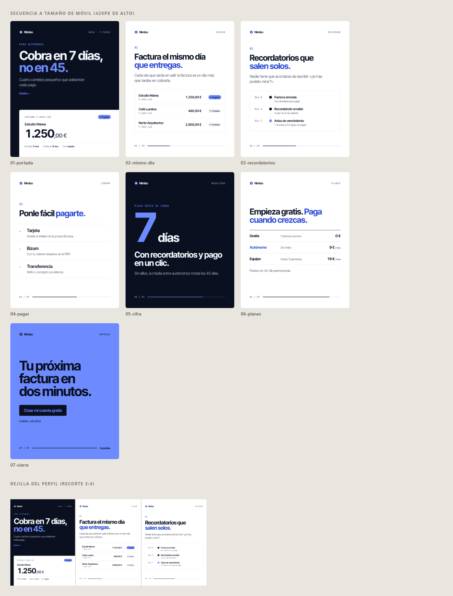

# claude-skills-marketing

Marketplace privado de plugins para **Claude Code** con skills para hacer piezas de marketing visual con nivel de
agencia **para cualquier marca o proyecto**: correos HTML, carruseles de Instagram, portadas, banners, miniaturas,
imágenes OG, stories, heros de correo y reels. La estética es **sobria y plana**: una tipografía, neutros y un acento,
nada de brillos, sombras ni bordes de color.

La marca es un **parámetro**. La skill `direccion-de-arte` empieza pidiendo o leyendo el brief de marca (nombre,
colores, tipografía, logo, tono) y lo guarda en un `marca.json`; las plantillas lo aplican solas (variables CSS en
las piezas, marcadores en los correos). Los ejemplos usan **Pliego**, una marca ficticia de facturación para
autónomos.

Todas las skills siguen la misma regla: **no se entrega nada que no se haya renderizado con un Chrome real y mirado**.
Los scripts exportan a PNG y revisan lo que suele salir mal: texto cortado o fuera, textos que se pisan, texto que
choca con una tarjeta, bloques sin aire, viudas en titulares, márgenes, contraste, fuentes que no cargan, imágenes
rotas o ampliadas y, en correos, compatibilidad con Gmail, Outlook y Apple Mail.

| Carrusel 1080x1350 | Campaña en 5 formatos | Correo «producto» |
|---|---|---|
|  |  |  |

La misma plantilla con otra marca (otro `marca.json`, sin tocar el HTML):


## Instalación

Como el repositorio es privado, Claude Code necesita acceso a GitHub: `gh auth login` hecho, o `GITHUB_TOKEN` /
`GH_TOKEN` en el entorno.

```
/plugin marketplace add C4rI0s/claude-skills-marketing
/plugin install direccion-de-arte@claude-skills-marketing
/plugin install correos-marketing@claude-skills-marketing
/plugin install carruseles-instagram@claude-skills-marketing
/plugin install piezas-graficas@claude-skills-marketing
/plugin install video-marketing@claude-skills-marketing
```

Desde una copia local: `claude plugin marketplace add ./claude-skills-marketing`.

Para los vídeos, instala también el motor de animación:

```
/plugin marketplace add FefeRP/motion-graphics-skills
/plugin install motion-graphics@motion-graphics-skills
```

Para actualizar: `/plugin marketplace update claude-skills-marketing`.

### Requisitos de los scripts
- **Node 18 o superior.**
- **Chrome o Edge** instalados. Los scripts los usan directamente, así que no hace falta descargar ningún navegador.
  Si no hay ninguno, define `CHROME_PATH` o ejecuta `npx playwright install chromium`.
- La primera vez, en la carpeta `scripts/` de cada skill: `npm install` (solo instala `playwright-core`). Claude lo
  hace solo cuando sigue la skill. `comprobar-marca.mjs` y `aplicar-marca.mjs` no necesitan nada.
- **ffmpeg** para revisar vídeos por fotogramas (`reel-de-marketing`).

## Plugins y skills

| Plugin | Skill | Para qué |
|---|---|---|
| `direccion-de-arte` | `direccion-de-arte` | La base: **brief de marca → `marca.json`** con `comprobar-marca.mjs` (campos y contraste de cada pareja de color), brief de la pieza, copy, tipografía, rejillas y zonas seguras, color y la **revisión visual obligatoria**. Las demás skills la usan |
| `correos-marketing` | `correo-marketing-html` | Correos de marketing sobrios. Plantillas `producto`, `anuncio` y `oferta`; `aplicar-marca.mjs` las pasa a tu marca y `comprobar-correo.mjs` hace comprobaciones estáticas y renderiza **escritorio, móvil, sin imágenes y modo oscuro** |
| `carruseles-instagram` | `carrusel-instagram` | Carruseles 1080x1350 con un sistema de diapositivas (portada, punto con maqueta, línea de tiempo, lista, cifra, tabla, cierre). `exportar.mjs --marca marca.json --carrusel` genera los PNG, la hoja de contacto y la rejilla 3:4 del perfil |
| `piezas-graficas` | `piezas-graficas` | Hero de correo, OG, miniatura de YouTube, banner de X, story y otros formatos, con maquetas de producto escalables y un recortador exacto de capturas |
| `piezas-graficas` | `imagen-ia` | Imágenes de apoyo con IA (Higgsfield u otro) sin el «look IA»: prompts con la paleta de la marca, control de gasto y revisión |
| `video-marketing` | `reel-de-marketing` | Reels y vídeos cortos: guion por segundos, zonas seguras 9:16, subtítulos y revisión por fotogramas, sobre motion-graphics (Remotion) |

## Uso rápido

Puedes pedirlo en lenguaje normal; Claude elige la skill:

- «Esta es la web de mi cliente: saca su marca y hazme un carrusel de 6 diapositivas sobre su nuevo servicio».
- «Correo de lanzamiento con la plantilla de producto para la marca de `./marca.json`, y compruébalo».
- «La misma campaña en OG, miniatura, banner de X y story».

O a mano:

```bash
# Marca
node plugins/direccion-de-arte/skills/direccion-de-arte/scripts/comprobar-marca.mjs marca.json
# Carrusel o piezas
node plugins/carruseles-instagram/skills/carrusel-instagram/scripts/exportar.mjs mi-carrusel.html --marca marca.json --carrusel
node plugins/piezas-graficas/skills/piezas-graficas/scripts/exportar.mjs mis-piezas.html --marca marca.json
# Correo
node plugins/correos-marketing/skills/correo-marketing-html/scripts/aplicar-marca.mjs plantillas/producto.html marca.json -o correo.html
node plugins/correos-marketing/skills/correo-marketing-html/scripts/comprobar-correo.mjs correo.html --marketing
```

## Estructura

```
.claude-plugin/marketplace.json        catálogo del marketplace
plugins/<plugin>/.claude-plugin/plugin.json
plugins/<plugin>/skills/<skill>/SKILL.md
                                /plantillas/   HTML de partida (y marca.json de ejemplo) con contenido de Pliego
                                /scripts/      exportadores y comprobadores (Node + playwright-core)
                                /references/   guías que la skill carga cuando las necesita
docs/ejemplos/                         renders de las plantillas
```

## Añadir o cambiar una skill
1. Crea `plugins/<plugin>/skills/<nombre>/SKILL.md` con el frontmatter `name` y `description`. La descripción dice
   **cuándo** usarla, porque es lo que hace que Claude la elija.
2. Si es un plugin nuevo, añade su `plugin.json` y su entrada en `.claude-plugin/marketplace.json`.
3. Si trae plantillas, que lean la marca de `marca.json` (variables CSS o marcadores `%%…%%`), renderízalas con su
   script, míralas y deja el resultado en `docs/ejemplos/`. Nada de marcas reales en las plantillas.
4. Sube la `version` del plugin y `metadata.version` para que `/plugin marketplace update` lo recoja.

Uso privado. No se publica.
