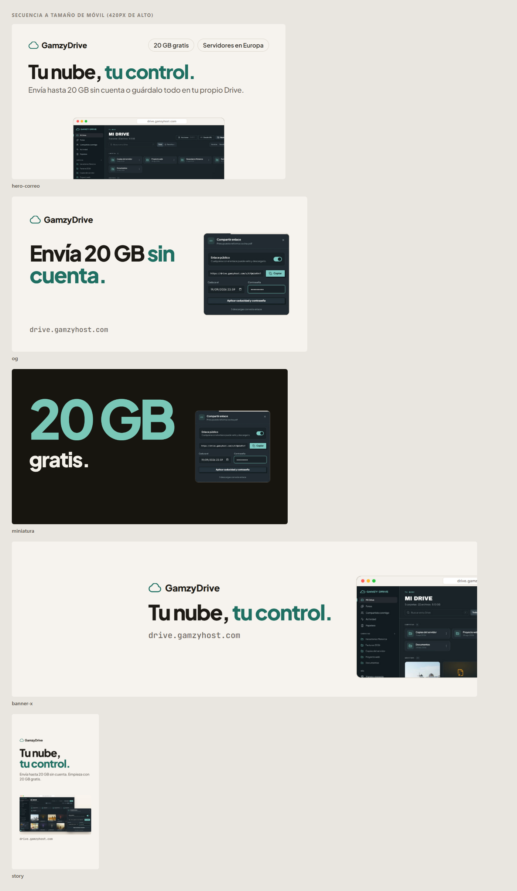

# claude-skills-marketing

Marketplace privado de plugins para **Claude Code** con skills para hacer piezas de marketing y multimedia con
nivel de agencia: correos HTML, carruseles de Instagram, portadas, banners, miniaturas, imágenes OG, stories, heros
de correo y reels. La estética es **sobria y plana**, la de GamzyHost: fondo blanco o crema, una tipografía, un acento,
nada de brillos, sombras ni bordes de color.

Todas las skills siguen la misma regla: **no se entrega nada que no se haya renderizado con un Chrome real y mirado**.
Cada una trae plantillas probadas y un script que exporta a PNG y revisa lo que suele salir mal (texto cortado,
márgenes, contraste, fuentes que no cargan, imágenes rotas o ampliadas y, en correos, compatibilidad con Gmail,
Outlook y Apple Mail).

| Correo «producto» | Carrusel 1080x1350 | Campaña en 5 formatos |
|---|---|---|
|  |  |  |

## Instalación

Como el repositorio es privado, Claude Code necesita acceso a GitHub. Basta con tener `gh auth login` hecho, o
`GITHUB_TOKEN` / `GH_TOKEN` en el entorno.

```
/plugin marketplace add C4rI0s/claude-skills-marketing
/plugin install direccion-de-arte@claude-skills-marketing
/plugin install correos-marketing@claude-skills-marketing
/plugin install carruseles-instagram@claude-skills-marketing
/plugin install piezas-graficas@claude-skills-marketing
/plugin install video-marketing@claude-skills-marketing
```

Para los vídeos, instala también el motor de animación:

```
/plugin marketplace add FefeRP/motion-graphics-skills
/plugin install motion-graphics@motion-graphics-skills
```

Para actualizar: `/plugin marketplace update claude-skills-marketing`.

### Requisitos de los scripts
- **Node 18 o superior.**
- **Chrome o Edge** instalados. Los scripts los usan directamente, así que no hace falta descargar ningún navegador.
  Si no hay ninguno, define `CHROME_PATH` o ejecuta `npx playwright install chromium`.
- La primera vez, en la carpeta `scripts/` de cada skill: `npm install` (solo instala `playwright-core`). Claude lo
  hace solo cuando sigue la skill.
- **ffmpeg** para revisar vídeos por fotogramas (`reel-de-marketing`).

## Plugins y skills

| Plugin | Skill | Para qué |
|---|---|---|
| `direccion-de-arte` | `direccion-de-arte` | La base: brief, copy, tipografía, rejillas y zonas seguras, color, marca GamzyHost y la **revisión visual obligatoria**. Las demás skills la usan |
| `correos-marketing` | `correo-marketing-html` | Correos de marketing al nivel de Proton. Plantillas `producto`, `anuncio` y `oferta`, y `comprobar-correo.mjs`, que hace comprobaciones estáticas y renderiza **escritorio, móvil, sin imágenes y modo oscuro** |
| `carruseles-instagram` | `carrusel-instagram` | Carruseles 1080x1350 con un sistema de diapositivas (portada, punto, lista, cifra, tabla, cierre). `exportar.mjs --carrusel` genera los PNG, la hoja de contacto y la rejilla 3:4 del perfil |
| `piezas-graficas` | `piezas-graficas` | Hero de correo, OG, miniatura de YouTube, banner de X, story y otros formatos, con un recortador exacto de capturas |
| `piezas-graficas` | `imagen-ia` | Imágenes de apoyo con IA (Higgsfield) sin el «look IA»: prompts, bloques de estilo, control de gasto y revisión |
| `video-marketing` | `reel-de-marketing` | Reels y vídeos cortos: guion por segundos, zonas seguras 9:16, subtítulos y revisión por fotogramas, sobre motion-graphics |

## Uso rápido

Puedes pedirlo en lenguaje normal; Claude elige la skill:

- «Hazme el correo de lanzamiento de GamzyMail con la plantilla de producto y compruébalo».
- «Un carrusel de 6 diapositivas sobre cómo hacer copias del servidor con GamzyDrive».
- «La misma campaña en OG, miniatura, banner de X y story».

O a mano:

```bash
# Correo
node plugins/correos-marketing/skills/correo-marketing-html/scripts/comprobar-correo.mjs mi-correo.html --marketing
# Carrusel o piezas
node plugins/carruseles-instagram/skills/carrusel-instagram/scripts/exportar.mjs mi-carrusel.html --carrusel
node plugins/piezas-graficas/skills/piezas-graficas/scripts/exportar.mjs mis-piezas.html
```

## Estructura

```
.claude-plugin/marketplace.json        catálogo del marketplace
plugins/<plugin>/.claude-plugin/plugin.json
plugins/<plugin>/skills/<skill>/SKILL.md
                                /plantillas/   HTML de partida con contenido real de ejemplo
                                /scripts/      exportadores y comprobadores (Node + playwright-core)
                                /references/   guías que la skill carga cuando las necesita
docs/ejemplos/                         renders de las plantillas
```

## Añadir o cambiar una skill
1. Crea `plugins/<plugin>/skills/<nombre>/SKILL.md` con el frontmatter `name` y `description`. La descripción dice
   **cuándo** usarla, porque es lo que hace que Claude la elija.
2. Si es un plugin nuevo, añade su `plugin.json` y su entrada en `.claude-plugin/marketplace.json`.
3. Si trae plantillas, renderízalas con su script, míralas y deja el resultado en `docs/ejemplos/`.
4. Sube la `version` del plugin para que `/plugin marketplace update` lo recoja.

Uso privado de GamzyHost. No se publica.
